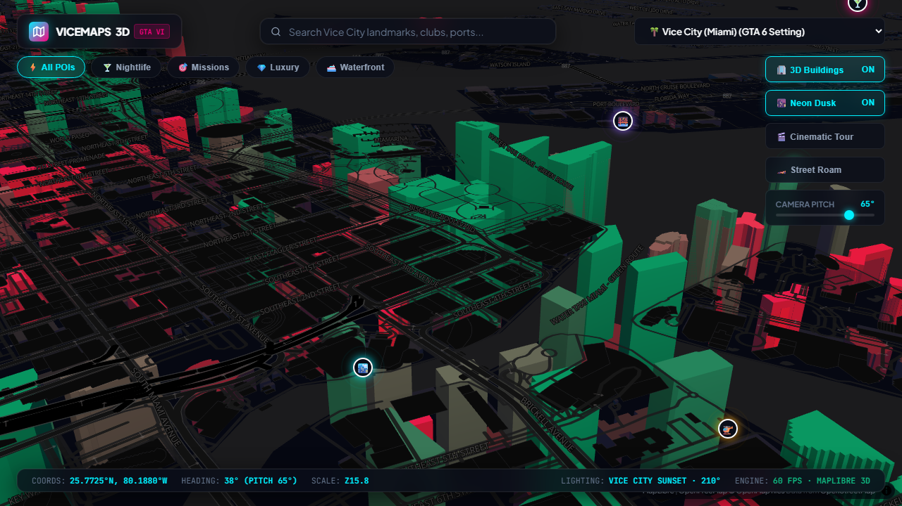
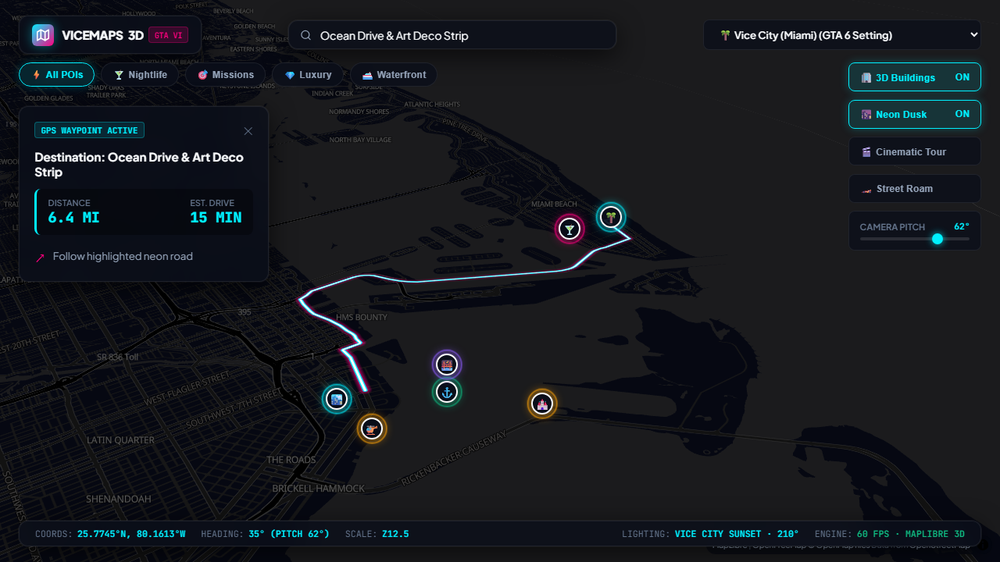
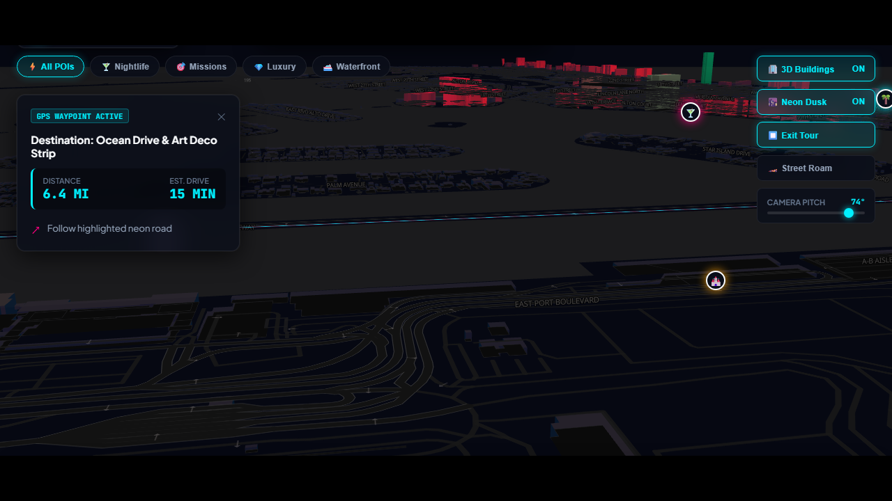
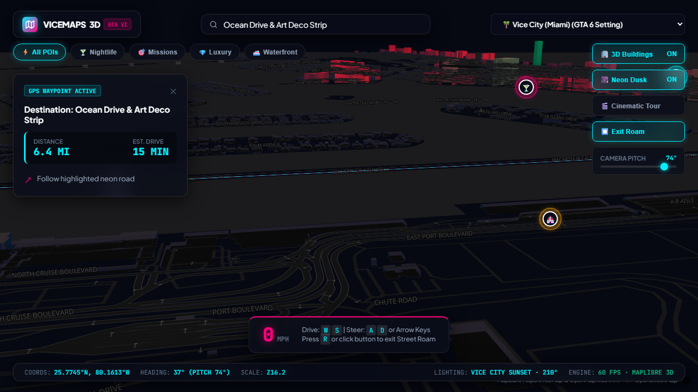
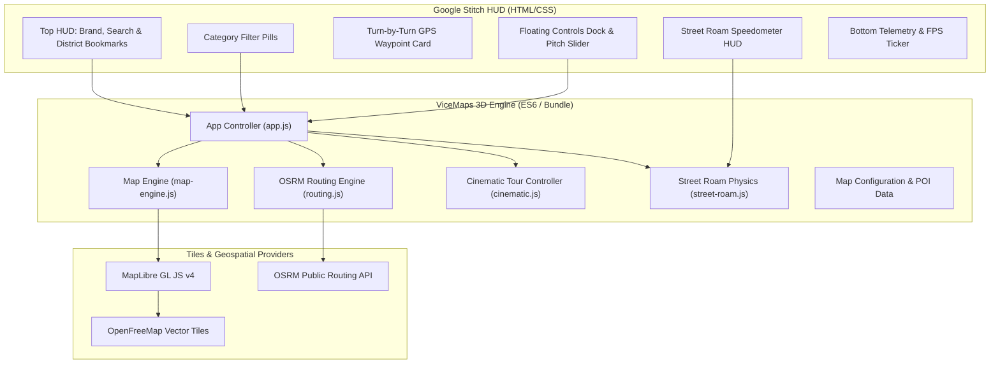

# 🌴 ViceMaps 3D · GTA VI Dusk Map Engine

> Next-generation 3D Google Maps clone inspired by the **Grand Theft Auto VI Trailer** (at 8:21), featuring procedural and vector-tile 3D skyscraper extrusions, sunset directional lighting, neon dusk cartography, real-time GPS waypoint routing, cinematic orbital camera tours, and first-person street roam.



---

## 🌟 Visual Showcase

| GTA VI 3D Dusk Cartography | GPS Waypoint Navigation |
|:---:|:---:|
|  |  |
| *Skyscrapers extruded with cyan/magenta tops at dusk* | *Pulsing neon vector path across Biscayne Bay* |

| Cinematic Orbit Tour | First-Person Street Roam |
|:---:|:---:|
|  |  |
| *Letterboxed flyovers around iconic landmarks* | *WASD driving physics with neon speedometer* |

---

## ⚡ Core Features

- **GTA VI Trailer Cartography (8:21 Aesthetic)**:
  - Deep asphalt canvas (`#060812`) with neon magenta (`#ff007f`) and electric cyan (`#00f0ff`) vectors.
  - Realistic sunset lighting with low-angle azimuth (210°) and altitude (32°).
  - Skyscraper height extrusion ramp (from deep slate up to radiant cyan crowns > 120m).
- **Google Stitch Anti-Slop HUD**:
  - Ultra-minimalist frosted glass panels (`backdrop-filter: blur(18px)`).
  - Search autocomplete with fuzzy POI lookup.
  - Category filters: Nightlife, Missions, Luxury, Waterfront.
  - District switcher: Vice City / Miami, Star Island, Los Santos, Liberty City, Tokyo Neo.
  - Real-time telemetry ticker: coordinates, heading, pitch, scale, lighting angle, and 60 FPS counter.
- **Turn-by-Turn GPS Waypoint Routing**:
  - OpenStreetMap / OSRM routing engine with fallback bezier vector synthesis.
  - Turn-by-turn navigation HUD displaying distance, estimated drive time, and maneuver prompts.
  - Animated multi-layer glowing neon road polyline.
- **Cinematic Orbit Tour Mode (`Key C`)**:
  - Smooth 360° dynamic camera flyover around skyscrapers with 2.39:1 widescreen cinema letterbox bars.
- **Street Roam Physics Engine (`Key R`)**:
  - Low-altitude (12m), high-pitch (82°) first-person camera mode.
  - WASD / Arrow key driving controls with acceleration, coasting friction, and real-time MPH speedometer.
- **Zero-API-Key Architecture**:
  - Powered by MapLibre GL JS v4 and OpenFreeMap vector tiles with built-in procedural geometry fallback.

---

## 🚀 Quickstart

ViceMaps 3D is 100% client-side with zero external build dependencies required at runtime.

### Option 1: Local HTTP Server (Recommended)
```bash
git clone https://github.com/Arnav1771/vicemaps-3d.git
cd vicemaps-3d
python -m http.server 5055
```
Open **[http://localhost:5055](http://localhost:5055)** in your browser.

### Option 2: Direct Double-Click (`file:///`)
Simply double-click `index.html` in Windows Explorer or macOS Finder. The bundled engine (`js/bundle.js`) runs natively without CORS restrictions.

---

## 🕹️ Controls & Hotkeys

| Action | Control / Key |
|---|---|
| **Rotate / Orbit Camera** | Right Click + Drag or `Ctrl` + Left Click + Drag |
| **Pitch Camera** | Right Click + Drag Up/Down or Dock Pitch Slider |
| **Street Roam Mode** | `R` key or Dock button |
| **Drive Forward / Reverse** | `W` / `S` or `Up` / `Down` Arrow (in Street Roam) |
| **Steer Left / Right** | `A` / `D` or `Left` / `Right` Arrow (in Street Roam) |
| **Cinematic Flyover Tour** | `C` key or Dock button |
| **Toggle Neon Dusk Palette** | `N` key or Dock button |
| **Toggle 3D Buildings** | Dock button |
| **Cancel Active GPS Route** | Close button (`✕`) on Route HUD |

---

## 🏗️ Architecture



---

## 🧪 Automated Testing with Canary Browser

Automated end-to-end verification runs via Canary Browser CLI:

```bash
npx @usecanary/browser --headless run tests/canary_test.js
```

Verified test coverage:
1. `Map canvas & WebGL initialization`: Verified.
2. `3D Building Extrusions rendering`: Verified.
3. `Dusk lighting parameters (210° az, 32° alt)`: Verified.
4. `Search autocomplete & POI selection`: Verified.
5. `Turn-by-turn GPS routing & distance calculation`: Verified.
6. `Cinematic orbit tour activation`: Verified.
7. `Street roam speedometer HUD & physics`: Verified.

---

## 📄 License

MIT License © 2026 Arnav Bhargava.
